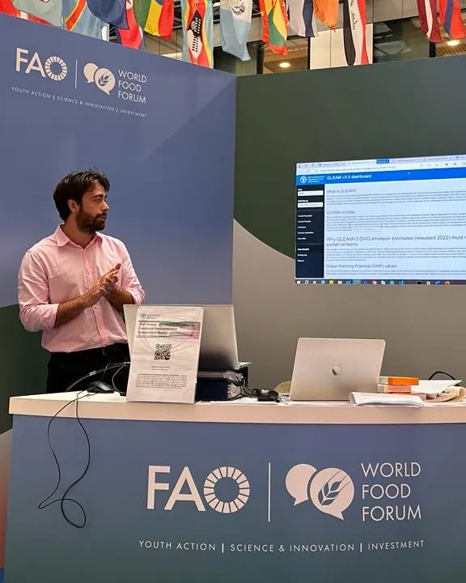

```{=html}
<figure class="about-photo">
  
  <figcaption>Presenting the GLEAM dashboard at FAO's World Food Forum, Rome, 2023</figcaption>
</figure>
```

I'm a humanitarian researcher and GIS and data specialist. Over seven years with IMPACT Initiatives (REACH), ICRC and FAO, I've worked on needs assessments, displacement and market monitoring, climate and remote sensing, and emissions modelling, across sectors from food security and water and sanitation to protection and education.

I started with IMPACT Initiatives (REACH) in Ukraine and then South Sudan, where over three years I went from Junior GIS Officer to GIS Specialist. There I managed a team of six, ran a satellite-based climate monitoring system, and worked with South Sudan's National Bureau of Statistics on the national FSNMS household survey. At FAO in Rome I analysed livestock emissions with GLEAM and designed a geospatial data warehouse on Google Cloud. At ICRC in Ukraine I was the delegation's GIS and data focal point, using remote sensing in ArcGIS Pro and Google Earth Engine to monitor floods, crops and critical sites near the frontline, and managed a team of three. I'm now a Senior Research Officer with IMPACT Initiatives (REACH), leading the 2026 needs assessment for northern Nigeria from Dakar.

## Education

```{=html}
<ul class="cv-list">
  <li><span class="when">2017 – 2018</span><span class="what"><strong>MSc Geographic Information Science</strong> (Merit)<span class="where">University College London (UCL)</span></span></li>
  <li><span class="when">2013 – 2016</span><span class="what"><strong>BSc Physical Geography</strong><span class="where">Swansea University</span></span></li>
</ul>
```

## Languages

English (native) · Spanish (basic, currently studying) · French (beginner, currently studying)

## Get in touch

LinkedIn is the best way to reach me.

```{=html}
<div class="button-row">
  <a class="btn-jp primary" href="https://www.linkedin.com/in/jackphilpottgis/"><i class="bi bi-linkedin" aria-hidden="true"></i> Message me on LinkedIn</a>
  <a class="btn-jp" href="files/CV_JackPhilpott.pdf"><i class="bi bi-file-earmark-arrow-down" aria-hidden="true"></i> Download CV (PDF)</a>
  <a class="btn-jp" href="https://github.com/JackPhilpott"><i class="bi bi-github" aria-hidden="true"></i> GitHub</a>
</div>
```
