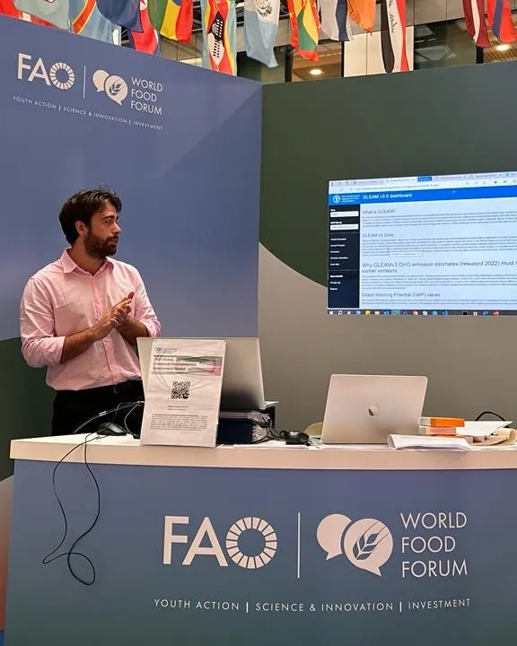
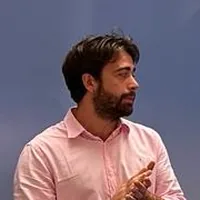
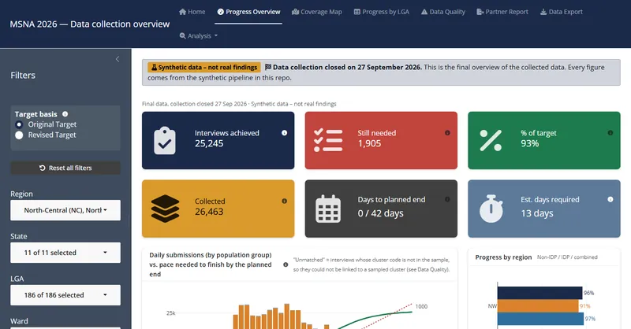
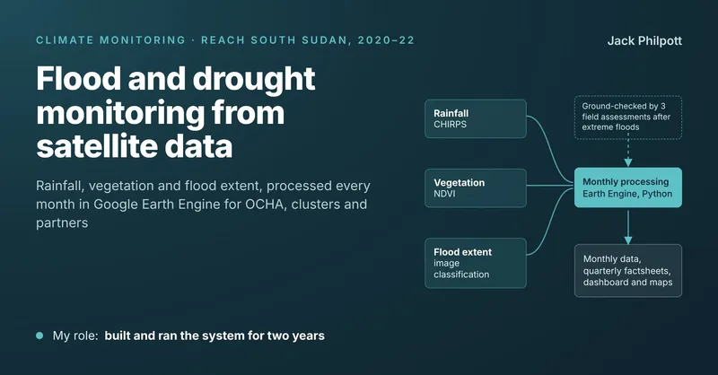
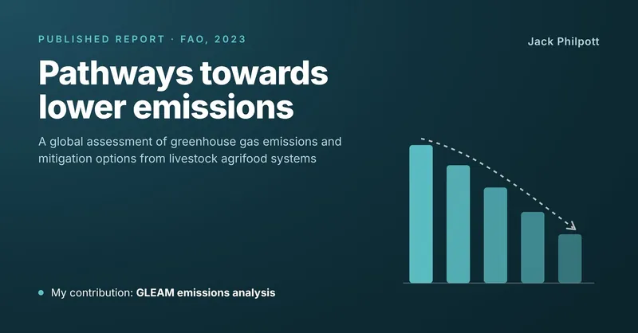

::: {.column-margin .hero-photo}
{fig-alt="Jack Philpott presenting the GLEAM v3.0 dashboard at an FAO World Food Forum stand"}
:::

::: {.hero}
::: {.hero-text}
```{=html}

```

<p class="eyebrow">GIS and data specialist · Humanitarian research</p>

# Jack Philpott

<p class="lead">I design and run the data behind humanitarian decisions: household surveys, geospatial analysis and remote sensing.</p>

Seven years with IMPACT Initiatives (REACH), ICRC and FAO, in Nigeria, Ukraine, South Sudan and on global programmes. I'm currently a Senior Research Officer with IMPACT Initiatives (REACH), leading the 2026 needs assessment for northern Nigeria from Dakar.

```{=html}
<div class="button-row">
  <a class="btn-jp primary" href="files/CV_JackPhilpott.pdf"><i class="bi bi-file-earmark-arrow-down" aria-hidden="true"></i> Download CV (PDF)</a>
  <a class="btn-jp" href="work/index.html"><i class="bi bi-grid-3x2-gap" aria-hidden="true"></i> See my work</a>
  <a class="btn-jp" href="https://www.linkedin.com/in/jackphilpottgis/"><i class="bi bi-linkedin" aria-hidden="true"></i> LinkedIn</a>
  <a class="btn-jp" href="https://github.com/JackPhilpott"><i class="bi bi-github" aria-hidden="true"></i> GitHub</a>
</div>
```
:::

:::

```{=html}
<dl class="facts">
  <div><dt>Experience</dt><dd>7 years in humanitarian research, data and GIS</dd></div>
  <div><dt>Organisations</dt><dd>IMPACT Initiatives (REACH) · ICRC · FAO</dd></div>
  <div><dt>Countries</dt><dd>Nigeria · Senegal · Ukraine · South Sudan · Italy</dd></div>
  <div><dt>Languages</dt><dd>English (native) · Spanish (basic) · French (beginner)</dd></div>
</dl>

<div class="section-head">
  <h2 id="selected-work">Selected work</h2>
  <a href="work/index.html">All work →</a>
</div>

<div class="feature-grid">
  <article class="feature">
    <a class="thumb" href="work/nigeria-msna.html" tabindex="-1" aria-hidden="true">
      
    </a>
    <div class="body">
      <p class="eyebrow">Household survey · Nigeria · 2026</p>
      <h3><a href="work/nigeria-msna.html">A 32,000-household needs assessment under access constraints</a></h3>
      <p>Sampling, daily monitoring and automated cleaning, with more than 20 partner organisations.</p>
      <div class="links"><a href="work/nigeria-msna.html">Case study</a><a href="https://jackphilpott.shinyapps.io/msna-monitoring/">Dashboard demo</a></div>
    </div>
  </article>

  <article class="feature">
    <a class="thumb" href="work/south-sudan-climate.html" tabindex="-1" aria-hidden="true">
      
    </a>
    <div class="body">
      <p class="eyebrow">Remote sensing · South Sudan · 2020–22</p>
      <h3><a href="work/south-sudan-climate.html">Flood and drought monitoring from satellite data</a></h3>
      <p>A Google Earth Engine system run for more than two years and checked on the ground after extreme floods.</p>
      <div class="links"><a href="work/south-sudan-climate.html">Case study</a></div>
    </div>
  </article>

  <article class="feature">
    <a class="thumb" href="https://openknowledge.fao.org/items/b3f21d6d-bd6d-4e66-b8ca-63ce376560b5" tabindex="-1" aria-hidden="true">
      
    </a>
    <div class="body">
      <p class="eyebrow">Emissions modelling · FAO · 2023–24</p>
      <h3><a href="https://openknowledge.fao.org/items/b3f21d6d-bd6d-4e66-b8ca-63ce376560b5">Livestock emissions and mitigation with GLEAM</a></h3>
      <p>Country, regional and global emissions analysis, including methane, and the public GLEAM dashboard.</p>
      <div class="links"><a href="https://openknowledge.fao.org/items/b3f21d6d-bd6d-4e66-b8ca-63ce376560b5">FAO report</a><a href="https://foodandagricultureorganization.shinyapps.io/GLEAMV3_Public/">Dashboard</a></div>
    </div>
  </article>
</div>

<div class="section-head">
  <h2 id="experience">Experience</h2>
  <a href="files/CV_JackPhilpott.pdf">Full CV (PDF) →</a>
</div>
<ul class="cv-list">
  <li><span class="when">2026 – now</span><span class="what"><strong>Senior Research Officer</strong>, IMPACT Initiatives (REACH)<span class="where">Nigeria mission, based in Dakar, Senegal</span></span></li>
  <li><span class="when">2025 – 2026</span><span class="what"><strong>GIS &amp; Data Specialist</strong>, International Committee of the Red Cross (ICRC)<span class="where">Kyiv, Ukraine</span></span></li>
  <li><span class="when">2023 – 2024</span><span class="what"><strong>Geospatial Analyst</strong>, Food and Agriculture Organization of the UN (FAO)<span class="where">Rome, Italy</span></span></li>
  <li><span class="when">2019 – 2022</span><span class="what"><strong>Junior GIS Officer to GIS Specialist</strong>, IMPACT Initiatives (REACH)<span class="where">Juba, South Sudan</span></span></li>
  <li><span class="when">2018 – 2019</span><span class="what"><strong>GIS Intern</strong>, IMPACT Initiatives (REACH)<span class="where">Kyiv, Ukraine</span></span></li>
</ul>

<h2 id="skills">Skills</h2>
<div class="skill-groups">
  <section>
    <h3>Research and surveys</h3>
    <ul class="chips"><li>Needs assessments (MSNA)</li><li>Sampling design</li><li>Questionnaire design</li><li>KoboToolbox</li><li>Data quality assurance</li><li>IPC and Cadre Harmonisé</li></ul>
  </section>
  <section>
    <h3>Data and code</h3>
    <ul class="chips"><li>R (primary)</li><li>Python</li><li>SQL</li><li>PostgreSQL and PostGIS</li><li>Google BigQuery</li><li>Git</li></ul>
  </section>
  <section>
    <h3>GIS and remote sensing</h3>
    <ul class="chips"><li>ArcGIS Pro</li><li>QGIS</li><li>Google Earth Engine</li><li>FME</li><li>Satellite image classification</li></ul>
  </section>
  <section>
    <h3>Dashboards and maps</h3>
    <ul class="chips"><li>R Shiny</li><li>Power BI</li><li>Tableau</li><li>ArcGIS Dashboards and StoryMaps</li><li>Cartographic design</li></ul>
  </section>
  <section>
    <h3>Ways of working</h3>
    <ul class="chips"><li>Team leadership</li><li>Partner coordination</li><li>Training</li><li>AI-assisted development</li></ul>
  </section>
  <section>
    <h3>Education</h3>
    <ul class="plain"><li><strong>MSc Geographic Information Science</strong> (Merit), UCL, 2018</li><li><strong>BSc Physical Geography</strong>, Swansea University, 2016</li></ul>
  </section>
</div>
```
