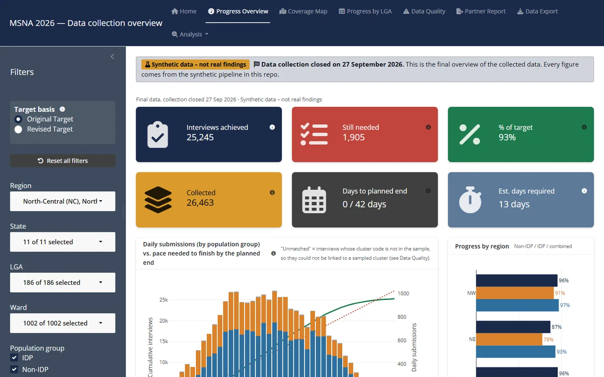
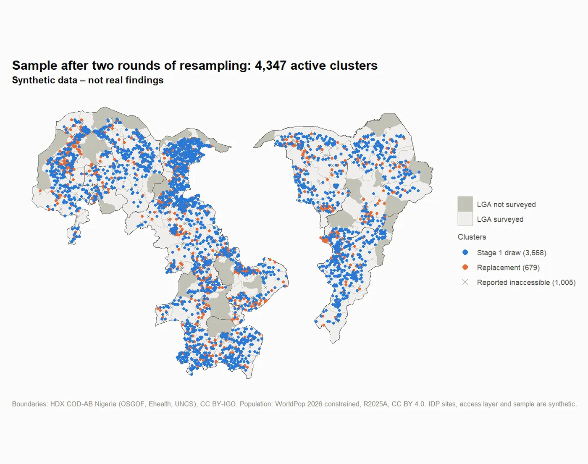
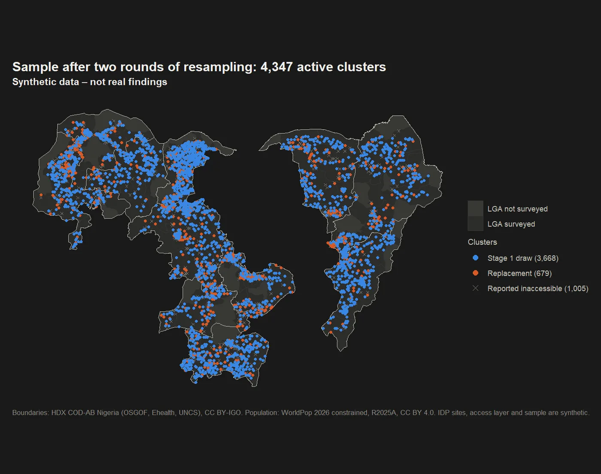

```{=html}
<dl class="dataplate">
  <div><dt>My role</dt><dd>Research lead for the assessment; led and supported a team of three</dd></div>
  <div><dt>Scale</dt><dd>32,000 households · 11 states · 176 LGAs</dd></div>
  <div><dt>Partners</dt><dd>20+ organisations · up to 1,000 interviews a day</dd></div>
  <div><dt>Tools</dt><dd>R · Python · KoboToolbox · R Shiny</dd></div>
</dl>
```

## The challenge

A Multi-Sector Needs Assessment (MSNA) is a large household survey whose findings help decide where humanitarian aid goes. In 2026 the northern Nigeria MSNA had to reach displaced people, refugees and host communities across 11 states, where insecurity put large areas out of reach, with more than 20 partners collecting up to 1,000 interviews a day.

## What I did

- **Sampling:** designed a two-stage cluster sample that kept coverage despite insecurity, and a resampling process that replaced unreachable clusters during fieldwork without breaking the design.
- **Monitoring and cleaning:** built an automated R and Python system that checked up to 1,000 submissions a day, with cleaning logs, a follow-up list for each partner and a live progress dashboard.
- **Coordination:** coordinated data collection with more than 20 partners and worked with Nigeria's National Bureau of Statistics.
- **The full cycle:** took the assessment from secondary data review and methodology to analysis and reporting.

## Outcome

- Findings presented to Nigeria's Cadre Harmonisé food security analysis, and being presented to partners, donors, clusters and agency heads.
- Each stage rebuilt as a public, runnable repository on synthetic data, so the methods can be seen without exposing survey data.

{loading="lazy" fig-alt="Dashboard page with progress totals, a daily submissions chart and progress by region and partner. Synthetic data."}

::: {.light-content}
{loading="lazy" fig-alt="Map of the 11 states with sampled, replacement and inaccessible clusters. Synthetic data."}
:::

::: {.dark-content}
{loading="lazy" fig-alt="Map of the 11 states with sampled, replacement and inaccessible clusters. Synthetic data."}
:::

## Links

- [Live dashboard demo](https://jackphilpott.shinyapps.io/msna-monitoring/) (synthetic data)
- [msna-pipeline](https://github.com/JackPhilpott/msna-pipeline): how the stages fit together
- [msna-sampling](https://github.com/JackPhilpott/msna-sampling): sampling and resampling
- [msna-monitoring](https://github.com/JackPhilpott/msna-monitoring): monitoring, cleaning and the dashboard

```{=html}
<div class="next-link">
  <a href="index.html">← All work</a>
  <a href="south-sudan-climate.html">Next case study: flood and drought monitoring →</a>
</div>
```
