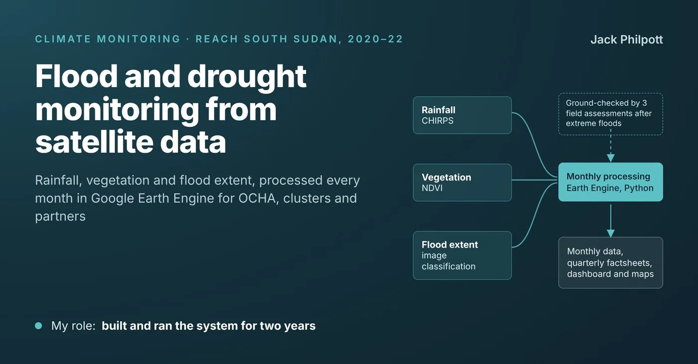

```{=html}
<dl class="dataplate">
  <div><dt>My role</dt><dd>Built and ran the system for more than two years</dd></div>
  <div><dt>Coverage</dt><dd>South Sudan and several East African countries</dd></div>
  <div><dt>Data</dt><dd>CHIRPS rainfall · NDVI · classified satellite flood extent</dd></div>
  <div><dt>Tools</dt><dd>Google Earth Engine (Python) · R · ArcGIS</dd></div>
</dl>
```

## The challenge

South Sudan had successive years of severe flooding from 2019 to 2021, with drought in other parts of the country. Much of the affected area was hard to reach on the ground, and partners needed regular, consistent information on where flooding and drought were happening and where they were likely to strike again.

## What I did

- **Built the monitoring:** a system in Google Earth Engine, written in Python, combining CHIRPS rainfall, NDVI vegetation data and satellite flood extent mapped by image classification.
- **Ran it every month** for more than two years, across South Sudan and several East African countries.
- **Turned it into products:** monthly data, quarterly factsheets, a dashboard, and static and story maps.
- **Checked it on the ground:** led three field assessments after extreme floods, verifying the flood mapping and documenting impacts on livelihoods.

## Outcome

- Used by OCHA, the clusters and partners, and fed the mission's wider shocks monitoring.
- Early-warning reports on long-term flood trends identified areas likely to flood again.

{loading="lazy" fig-alt="Diagram: CHIRPS rainfall, NDVI vegetation and classified flood extent feed monthly processing in Google Earth Engine, producing monthly data, quarterly factsheets, a dashboard and maps. Field assessments ground-check the processing."}

## Published examples

```{=html}
<ul class="output-list">
  <li><a href="https://repository.impact-initiatives.org/document/impact/c24a7620/REACH_SSD_Map_SMI_FloodFrequency2019_20_21_31JAN2022_A4-2.pdf">Flood frequency, 2019–2021</a><span class="meta">Map · January 2022</span></li>
  <li><a href="https://repository.impact-initiatives.org/document/impact/7deca445/REACH_SSD_Map_SMI_Eastern_Equatoria_Drought_JAN2022_A4.pdf">Drought severity, Eastern Equatoria</a><span class="meta">Map · January 2022</span></li>
  <li><a href="https://repository.impact-initiatives.org/document/impact/13389b24/REACH_SSD_Map_Flood_Exposure_Bentiu_Rubkona_2019_2022.pdf">Flood exposure and infrastructure, Bentiu and Rubkona</a><span class="meta">Map · 2022</span></li>
  <li><a href="https://repository.impact-initiatives.org/document/impact/3343d281/REACH_SSD_Profile_NBeG-Climate-Impact-Displacement_26Mar2021.pdf">Climate impact and displacement, Northern Bahr el Ghazal</a><span class="meta">Profile · March 2021</span></li>
</ul>
```

An open-data rebuild of this monitoring is in progress and will be added to the [Work](index.qmd) page.

```{=html}
<div class="next-link">
  <a href="nigeria-msna.html">← Previous case study</a>
  <a href="index.html">All work →</a>
</div>
```
